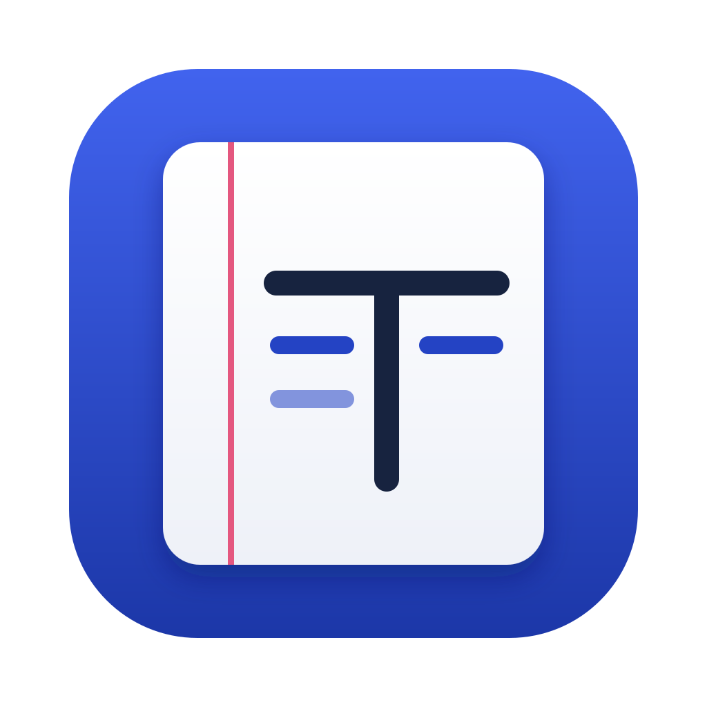

<div align="center">

# Johannes Grof

*Locked in* - 10k commits in 2026?

Austria · HTL Kaindorf an der Sulm · Swift · TypeScript · Rust

[](https://johannesgrof.me)
[](https://x.com/johannesgrofdev)
[](https://www.linkedin.com/in/johannes-grof)
[](mailto:contact@johannesgrof.me)

<!-- counters:start -->
**46** public repositories · **76** releases shipped · latest **[cswap v2.1.1](https://github.com/jx-grxf/cswap/releases/tag/v2.1.1)**
<!-- counters:end -->

</div>

### Servus, I'm Johannes.

I'm a developer from south-east Styria and a student at HTL Kaindorf. Most of my time goes
into ÖffiGo and Kontobuch. Next to them I build Mac apps and developer tools, usually for a
problem I ran into myself: a workflow with too many steps, a device that won't cooperate, an
app that should exist and doesn't.

<!-- now:start -->
**On the workbench right now:** [johannesgrof.me](https://github.com/jx-grxf/johannesgrof.me), last pushed 27 Oct 2026.
<!-- now:end -->

---

## ÖffiGo · The transit app for all of Austria

<a href="https://oeffigo.app"></a>

**Routes, departures and step-by-step guidance for bus, train and tram, native on iPhone and Apple Watch.**

From village to city, in the app, on the wrist and on the lock screen. Every departure time
shows whether it comes from the operator or the timetable, and when a connection gets tight,
ÖffiGo already has a plan B. No ads, no account. A SwiftUI app on a TypeScript/Rust backend,
running on Verkehrsauskunft Österreich (VAO).

Currently a **closed TestFlight beta** for iPhone (iOS 17+) and Apple Watch. Android is
paused for now.


**[See the app and request a beta place →](https://oeffigo.app)** · [Live punctuality](https://oeffigo.app/en/puenktlichkeit/) · [System status](https://status.oeffigo.app/)

<br>

<a href="https://kontobuch.johannesgrof.me"></a>

**[Kontobuch](https://kontobuch.johannesgrof.me)** is a digital accounting notebook for
Austrian schools. Write journal entries, calculate discounts and VAT, and get help with the
next step. Free, no sign-up, on macOS, Windows, Linux and the web.

<br clear="left">

---

## Selected work

**For coding agents**

| Project | What it does |
| :--- | :--- |
| **[PortPirate](https://johannesgrof.me/projects/portpirate/)** | Shows every local dev server on your Mac and which Claude Code or Codex session started it. Agents start a server on a free port per worktree with one MCP call, read its logs and only stop what is theirs.<br><sub>Swift · MCP · coming soon</sub> |
| **[CSwap](https://github.com/jx-grxf/cswap)** | Several Claude Code accounts side by side, each with its own login and live usage. When one runs out, `/swap` continues the same conversation on another account in the same terminal tab.<br><sub>Swift · CLI</sub> |
| **[dirhop](https://github.com/jx-grxf/dirhop)** | Jump to any folder from the terminal in a few keystrokes. Ranks your projects and the places you visit most at the top, on macOS, Linux and Windows.<br><sub>Rust · TUI</sub> |
| **[agent‑presence](https://github.com/jx-grxf/agent-presence)** | Discord Rich Presence for Claude Code and Codex. One static binary for macOS, Windows and Linux, no bot token.<br><sub>Rust · CLI</sub> |
| **[claude‑code‑todo‑fix](https://github.com/jx-grxf/claude-code-todo-fix)** | Brings the task list back to Claude Code on newer models. One flag in `settings.json`, one rule in `CLAUDE.md`, installers for bash and PowerShell that back up every file they touch.<br><sub>Shell · PowerShell</sub> |
| **[PatchPilot](https://github.com/jx-grxf/PatchPilot)** | A terminal coding agent for models you run yourself: Ollama, LM Studio, MLX, llama.cpp or vLLM. Every file edit and shell command shows up first, and the risky ones wait for your approval.<br><sub>TypeScript · Ollama</sub> |

**Mac apps**

| Project | What it does |
| :--- | :--- |
| **[DysonBar](https://github.com/jx-grxf/DysonBar)** | Air quality and controls for Dyson purifiers in the menu bar. After one MyDyson sign-in it talks to the purifier over your own Wi-Fi, without Dyson's cloud.<br><sub>Swift · MQTT</sub> |
| **[BriskEdit](https://github.com/jx-grxf/BriskEdit)** | A native Mac editor with an integrated terminal, Markdown preview and a Run button that finds the right toolchain for the file you are editing.<br><sub>Swift · AppKit</sub> |
| **[NotchTray](https://github.com/jx-grxf/NotchTray)** | Menu bar icons hidden behind the MacBook notch, back in reach through a dropdown under the notch.<br><sub>Swift · macOS</sub> |
| **[poise](https://github.com/jx-grxf/poise)** | Turns the motion sensors in your AirPods into a posture coach. No camera, no cloud, the motion data never leaves your Mac.<br><sub>Swift · CoreMotion</sub> |
| **[BottleLite](https://github.com/jx-grxf/BottleLite)** | Runs Windows apps on macOS through the Wine install you already have. Persistent bottles, safe `.exe` import, and logs, settings and a stop button for every program.<br><sub>Swift · Wine</sub> |
| **[MacPhone](https://github.com/jx-grxf/MacPhone)** | Android emulators and iOS simulators from one Mac, plus a bridge that mirrors a real Bluetooth LE device into an emulator, full GATT tree included.<br><sub>Swift · Bluetooth LE</sub> |

**Niche projects**

| Project | What it does |
| :--- | :--- |
| **[BeamMac](https://github.com/jx-grxf/BeamMac)** | Runs BeamNG.drive on Apple Silicon Macs. Installs Wine, the Metal graphics layers and Steam for Windows on its own, so all that is left is logging in to Steam.<br><sub>Swift · Wine · Metal</sub> |
| **[DriveTech](https://github.com/jx-grxf/beamng-drivetech)** | BMW-style driving electronics for BeamNG.drive: drive profiles from ECO PRO to SPORT+, DSC modes, xDrive, launch control and auto hold. Each feature stays off when the car lacks the hardware for it.<br><sub>Lua · BeamNG.drive</sub> |
| **[Caruso‑Reborn](https://github.com/jx-grxf/Caruso-Reborn)** | Internet radio and your own music back on first-generation T+A Caruso hi-fi systems, served from your computer as a local UPnP/DLNA source.<br><sub>TypeScript · UPnP</sub> |
| **[Tools](https://tools.johannesgrof.me)** | Merge, split, rotate and convert PDFs and images in the browser. Files never leave your device.<br><sub>TypeScript · pdf-lib</sub> |

<details>
<summary><b>More apps, experiments and rabbit holes</b></summary>

<br>

| Project | The idea |
| :--- | :--- |
| [CCrab](https://github.com/jx-grxf/CCrab) | A pixel crab on your desktop that reacts to Claude Code sessions, with your usage in the menu bar. |
| [cofload](https://github.com/jx-grxf/cofload) | A Claude Code plugin that routes bulk file reads to a cheaper model you already have. |
| [kontobuch-saldo](https://github.com/jx-grxf/kontobuch-saldo) | The booking model behind Kontobuch. Books business transactions in the Austrian standard chart of accounts, on the device. |
| [ip-multitool](https://github.com/jx-grxf/ip-multitool) | IP, DNS, RDAP, HTTP checks and subnet math for authorized network diagnostics. |
| [scooter-tuning-db](https://github.com/jx-grxf/scooter-tuning-db) | Community-documented BLE registers and tuning maps for e-scooters. |
| [opsec](https://github.com/jx-grxf/opsec) | Fake hacker mode for your terminal: `sudo opsec`. Pure show, touches nothing. |
| [SlamX](https://github.com/jx-grxf/SlamX) | Slap your MacBook and it knows. Real accelerometer, no microphone. |
| [DocxToPDF](https://github.com/jx-grxf/DocxToPDF) | Batch-convert DOCX to PDF on macOS with Word itself as the engine. |
| [johannesgrof.me](https://github.com/jx-grxf/johannesgrof.me) | My bilingual portfolio, built with Astro. It reads its own release data from GitHub. |

**[Browse all public repositories →](https://github.com/jx-grxf?tab=repositories)**

</details>

---

## Recent releases


Mac apps ship notarized with a Sparkle update feed. CLI tools ship through my own
Homebrew tap and Scoop bucket:

```bash
# macOS
brew install jx-grxf/tap/agent-presence

# Windows
scoop bucket add jx-grxf https://github.com/jx-grxf/scoop-bucket
scoop install agent-presence
```

Newest first:

<!-- releases:start -->
| Project | Version | Released |
| :--- | :--- | :--- |
| **[cswap](https://github.com/jx-grxf/cswap/releases/tag/v2.1.1)** | `v2.1.1` | 22 Oct 2026 |
| **[beamng-drivetech](https://github.com/jx-grxf/beamng-drivetech/releases/tag/v1.2.0)** | `v1.2.0` | 18 Oct 2026 |
| **[MacPhone](https://github.com/jx-grxf/MacPhone/releases/tag/v0.3.1)** | `v0.3.1` | 18 Oct 2026 |
| **[claude-code-todo-fix](https://github.com/jx-grxf/claude-code-todo-fix/releases/tag/v0.2.1)** | `v0.2.1` | 17 Oct 2026 |
| **[dirhop](https://github.com/jx-grxf/dirhop/releases/tag/v0.2.0)** | `v0.2.0` | 15 Oct 2026 |
<!-- releases:end -->

<sub>Refreshed from the public GitHub API every six hours. Stable releases only, no drafts or prereleases.</sub>

---

## What I work with

**Languages**

[](https://skillicons.dev)

**Platforms and frameworks**

[](https://skillicons.dev)

**Infrastructure and services**

[](https://skillicons.dev)

**Tooling**

[](https://skillicons.dev)


The full setup, from terminal to deploy targets, is on **[johannesgrof.me/uses](https://johannesgrof.me/uses/)**.

---

## Activity

<div align="center">

<picture>
  <source media="(prefers-color-scheme: dark)" srcset="https://raw.githubusercontent.com/jx-grxf/jx-grxf/output/snake-dark.svg">
  
</picture>

</div>

---

**Need something built or fixed?** I take on freelance websites, small tools, automation and
IT support. On site in south-east Styria, remote across Austria.

**[Let's talk →](mailto:contact@johannesgrof.me)** · [johannesgrof.me](https://johannesgrof.me)
